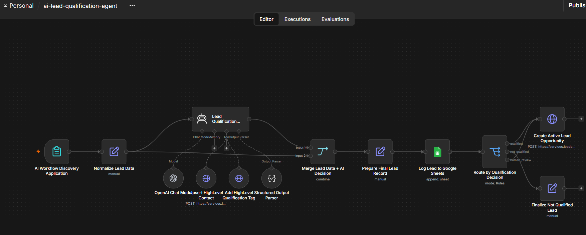
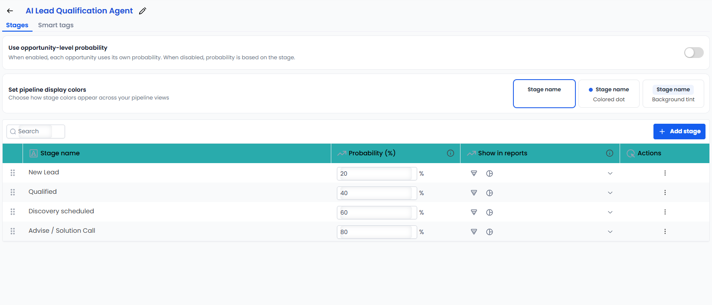
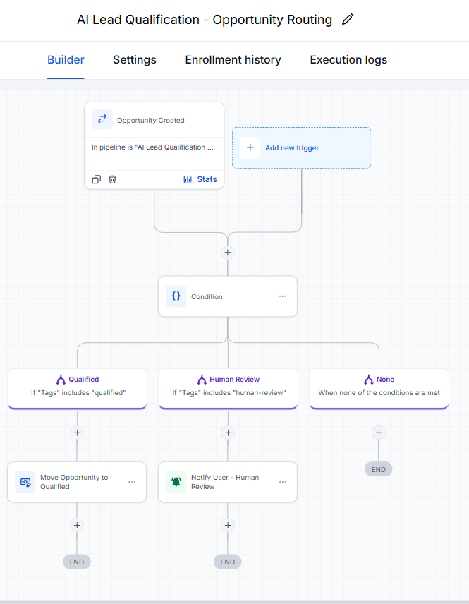
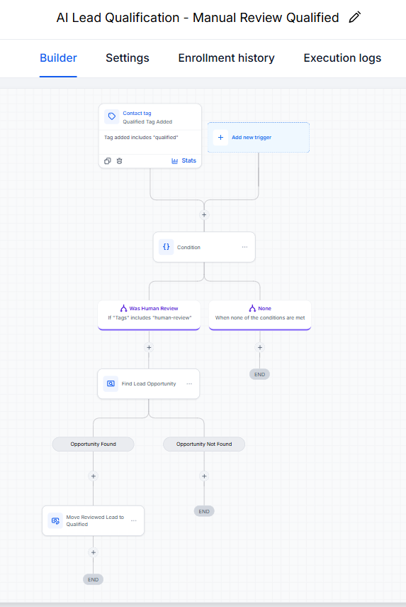
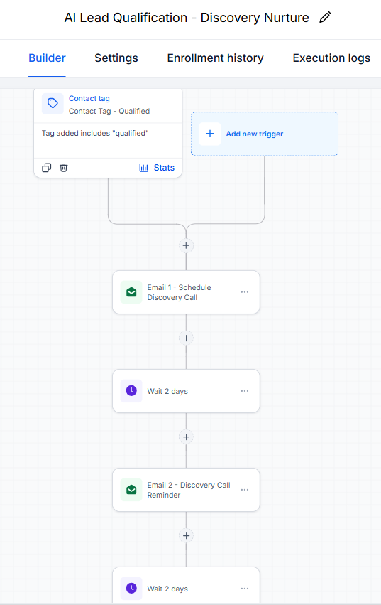
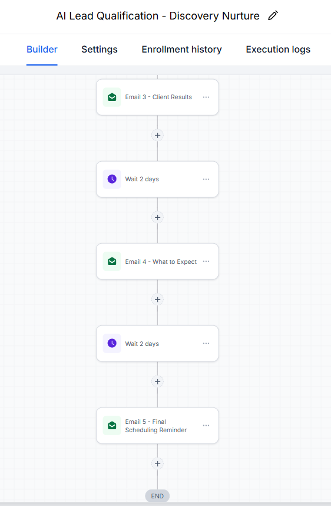
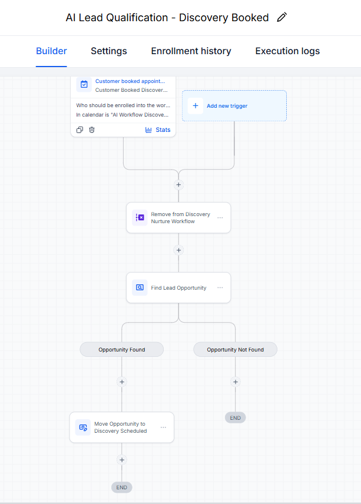

# AI Lead Qualification Agent

An agentic lead qualification and sales workflow built with **n8n, OpenAI, GoHighLevel, and Google Sheets**.

The system evaluates inbound leads for a fictional AI Workflow Implementation Package, creates or updates CRM contacts, applies qualification tags, logs decisions, creates sales opportunities, routes edge cases for human review, nurtures qualified leads, and advances booked prospects through the sales pipeline.

The project demonstrates AI-assisted decision-making, tool use, API integration, CRM automation, human-in-the-loop workflows, event-driven automation, and end-to-end system design.

---

## System Overview

A lead submits an application containing:

- Business information
- Operational problem
- Problem frequency
- Business impact
- Desired outcome
- Budget
- Decision-making authority
- Timeline
- Additional context

The application enters n8n, where the data is normalized and evaluated by an AI agent.

The agent returns one of three decisions:

```text
qualified
human_review
not_qualified
```

From there, n8n and GoHighLevel handle logging, CRM updates, opportunity creation, sales routing, nurture, appointment booking, and pipeline progression.



---

## Architecture

### n8n

n8n handles:

- Form intake
- Data normalization
- AI-agent orchestration
- Structured output parsing
- Lead data merging
- Google Sheets logging
- Qualification routing
- Opportunity creation

### AI Agent

The `Lead Qualification Agent` handles:

- Lead evaluation
- Qualification reasoning
- Confidence scoring
- Recommended next action
- GoHighLevel contact upsert
- Qualification tagging

### GoHighLevel

GoHighLevel handles:

- Contact management
- Sales pipeline management
- Human-review workflows
- Qualified-lead nurture
- Appointment scheduling
- Booking-triggered workflow changes
- Opportunity stage progression

### Google Sheets

Google Sheets provides an audit record containing the original application data, AI decision, reasoning, confidence, recommended action, and GoHighLevel contact ID.

---

## Qualification Logic

The fictional offer is:

```text
AI Workflow Implementation Package
Starting at $3,000
```

The agent evaluates factors including:

- Business operating status
- Presence of a real operational problem
- Automation potential
- Frequency of the problem
- Business impact
- Budget
- Decision-making authority
- Implementation timeline
- Ambiguous or conflicting information

Stronger-fit leads generally have an active business, a recurring operational problem with meaningful impact, budget consistent with the offer, decision authority, and a timeline within approximately 90 days.

Cases requiring additional judgment are routed to `human_review`.

---

## Structured Output

The agent returns:

```json
{
  "decision": "qualified | not_qualified | human_review",
  "reason": "string",
  "confidence": 0,
  "recommended_next_action": "string",
  "highlevel_contact_id": "string"
}
```

A Structured Output Parser validates the response before downstream processing.

---

## Agent Tools

The agent has access to two GoHighLevel tools.

### Upsert HighLevel Contact

The contact is created or updated using:

- Name
- Email
- Business name

The CRM source is recorded as:

```text
AI Lead Qualification Agent
```

The returned GoHighLevel contact ID becomes part of the structured agent output.

### Add Qualification Tag

The agent uses the returned contact ID to add the matching qualification tag:

| AI Decision | GoHighLevel Tag |
| --- | --- |
| `qualified` | `qualified` |
| `human_review` | `human-review` |
| `not_qualified` | `not-qualified` |

Existing contact tags remain intact.

---

## Lead Outcomes

### Qualified

A qualified lead:

1. Receives the `qualified` tag
2. Is logged to Google Sheets
3. Receives an open GoHighLevel opportunity
4. Moves into the `Qualified` pipeline stage
5. Enters the discovery-call nurture sequence

### Human Review

A lead requiring review:

1. Receives the `human-review` tag
2. Is logged to Google Sheets
3. Receives an open opportunity in `New Lead`
4. Enters the human-review workflow

A reviewer can then add either `qualified` or `not-qualified`.

An approved lead moves to `Qualified`.

A rejected lead is marked `Lost`.

### Not Qualified

A lead classified as `not_qualified`:

1. Receives the `not-qualified` tag
2. Is logged to Google Sheets
3. Exits the active sales path

---

## Sales Pipeline

The GoHighLevel pipeline is:

```text
New Lead
Qualified
Discovery scheduled
Advise / Solution Call
```

Qualification status and sales stage are kept separate.

For example:

- `human_review` describes the qualification decision
- `New Lead` describes the current sales stage
- `qualified` describes the qualification result
- `Qualified` represents accepted leads in the pipeline

The final `Advise / Solution Call` stage reflects a consultative sales process in which the salesperson presents a tailored recommendation after discovery.



---

## Human Review Workflows

### AI Lead Qualification - Opportunity Routing

Triggered when an opportunity is created in the `AI Lead Qualification Agent` pipeline.

If the contact has the `qualified` tag, the opportunity moves to `Qualified`.

If the contact has the `human-review` tag, the opportunity remains in `New Lead` and enters the human-review path.



### AI Lead Qualification - Manual Review Qualified

Triggered when `qualified` is manually added to a contact that previously received `human-review`.

The workflow:

1. Confirms the human-review state
2. Finds the existing opportunity
3. Moves it to `Qualified`



### AI Lead Qualification - Manual Review Not Qualified

Triggered when `not-qualified` is manually added to a contact that previously received `human-review`.

The workflow:

1. Confirms the human-review state
2. Finds the existing opportunity
3. Marks it `Lost`

---

## Discovery Nurture

Qualified leads enter:

```text
AI Lead Qualification - Discovery Nurture
```

The sequence contains five emails.

### Email 1 - Schedule Discovery Call

Sent immediately after qualification.

### Wait 2 days

### Email 2 - Discovery Call Reminder

Connects the prospect's stated operational problem with the potential value of automation.

### Wait 2 days

### Email 3 - Client Results

Highlights outcomes such as reduced manual work, fewer errors, and increased operational capacity.

### Wait 2 days

### Email 4 - What to Expect

Explains what happens during the discovery conversation and prepares the prospect for the call.

### Wait 2 days

### Email 5 - Final Scheduling Reminder

Provides a final invitation to book the discovery call.





---

## Discovery Booking Workflow

Appointment booking is handled by:

```text
AI Lead Qualification - Discovery Booked
```

Trigger:

```text
Customer Booked Appointment
```

Calendar:

```text
AI Workflow Discovery Call
```

When the prospect schedules:

1. The contact is removed from the discovery nurture workflow
2. GoHighLevel finds the contact's existing opportunity
3. The opportunity moves to `Discovery scheduled`

This creates an event-driven transition from nurture into the next sales stage as soon as the prospect books.



---

## Business Process Design

The workflow uses each system for the part of the process it handles best.

AI evaluates qualitative lead information and takes bounded CRM actions.

n8n coordinates the application, AI response, logging, routing, and opportunity creation.

GoHighLevel manages the ongoing sales lifecycle, including pipeline movement, nurture, appointments, and human review.

The automated journey ends at discovery scheduling. From there, the salesperson evaluates fit during the call and decides whether to schedule an `Advise / Solution Call`.

No-show handling, rescheduling, and post-discovery outcomes can be managed through appointment status, tags, opportunity status, and follow-up workflows without adding extra pipeline stages.

---

## Google Sheets Audit Log

Every evaluated lead is logged with:

- Timestamp
- Name
- Email
- Business name
- Business type
- Operating status
- Problem
- Frequency
- Business impact
- Desired outcome
- Budget
- Decision authority
- Timeline
- Additional notes
- Decision
- Reason
- Confidence
- Recommended next action
- HighLevel contact ID

This provides a searchable record of the original application, AI evaluation, and corresponding CRM contact.

---

## Testing Completed

The following paths were tested:

- Form submission
- Lead data normalization
- `qualified` classification
- `human_review` classification
- `not_qualified` classification
- Structured output parsing
- GoHighLevel contact upsert
- Existing-contact updates
- Qualification tag application
- Preservation of unrelated tags
- GoHighLevel contact ID capture
- Google Sheets logging
- n8n qualification routing
- Opportunity creation
- Initial placement in `New Lead`
- Automatic movement to `Qualified`
- Human-review routing
- Manual human-review approval
- Manual human-review rejection
- Existing opportunity lookup
- Lost opportunity status
- Discovery nurture enrollment
- Nurture workflow progression
- Removal from nurture after booking
- Discovery-booking workflow execution
- Movement to `Discovery scheduled`

---

## Technology

- n8n
- OpenAI API
- GPT-5.6 Luna
- GoHighLevel
- GoHighLevel REST API
- Google Sheets
- HTTP / REST
- JSON
- JSON Schema
- Docker
- Git
- GitHub

---

## n8n Workflow Nodes

The main n8n workflow includes:

```text
AI Workflow Discovery Application
Normalize Lead Data
Lead Qualification Agent
OpenAI Chat Model
Upsert HighLevel Contact
Add HighLevel Qualification Tag
Structured Output Parser
Merge Lead Data + AI Decision
Prepare Final Lead Record
Log Lead to Google Sheets
Route by Qualification Decision
Create Active Lead Opportunity
Finalize Not Qualified Lead
```

The two CRM tools connect directly to the n8n AI Agent tool interface.

---

## Security

The public workflow export is sanitized to remove credentials, account-specific identifiers, and test data.

Placeholders include:

```text
YOUR_HIGHLEVEL_LOCATION_ID
YOUR_HIGHLEVEL_PIPELINE_ID
YOUR_GOOGLE_SHEET_ID
```

Credentials are configured separately inside n8n.

---

## Running Locally

This project was developed with n8n running locally in Docker using a persistent volume.

```bash
docker run -it --rm --name n8n -p 5678:5678 -v n8n_data:/home/node/.n8n docker.n8n.io/n8nio/n8n
```

Then open:

```text
http://localhost:5678
```

---

## Setup

To reproduce the project:

1. Import the sanitized n8n workflow.
2. Configure the OpenAI credential.
3. Configure Google Sheets OAuth.
4. Configure the GoHighLevel Bearer credential.
5. Replace the placeholder GoHighLevel IDs.
6. Replace the placeholder Google Sheet ID.
7. Create the GoHighLevel pipeline.
8. Recreate the GoHighLevel workflows.
9. Create the discovery-call calendar.
10. Run test leads through the system.

---

## Possible Extensions

Future additions could include:

- No-show and rescheduling automation
- Post-discovery follow-up
- Dedicated API error handling and retries
- Invalid-output handling
- Reporting on qualification and conversion rates
- Sales performance dashboards
- CRM alerts for leads requiring human attention

---

## Project Goal

This project demonstrates how AI can operate inside a larger business system.

It combines:

- AI reasoning
- Structured output
- Agent tool use
- CRM API integration
- Deterministic automation
- Human review
- Sales nurture
- Appointment automation
- Audit logging
- Pipeline management
- Testing and troubleshooting

The result is an interconnected lead qualification and sales workflow spanning n8n, OpenAI, GoHighLevel, and Google Sheets.